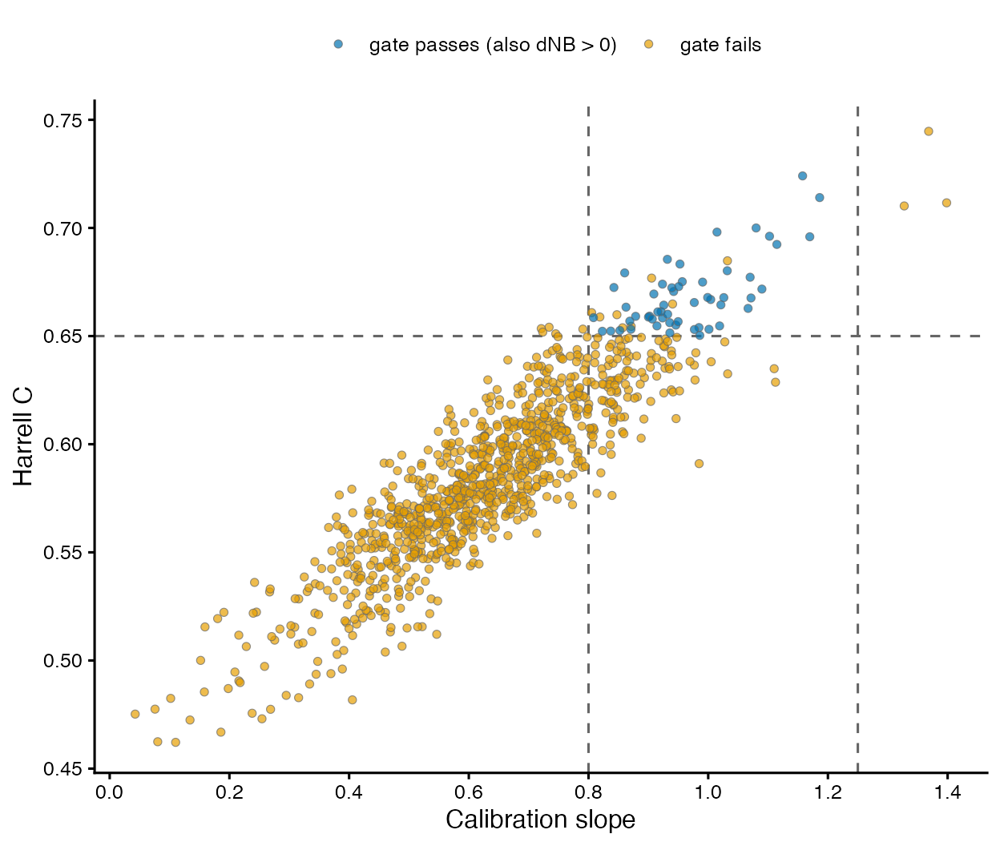
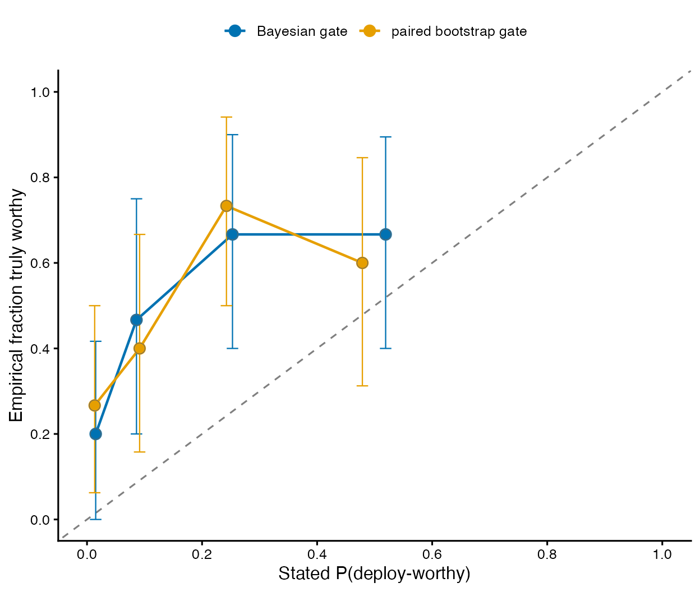

# Showcase: deployment decisions in a small local cohort

A published survival model must be validated in a **small, low-event
local cohort** (n = 120, ~55% censored) before a clinic decides whether
to deploy it. This is the single most common real external-validation
situation, and the one where classical point-estimate-plus-CI reporting
is weakest.

This showcase makes three claims and backs each with numbers from a
self-contained simulation where the truth is known throughout, so every
claim is checkable against an oracle. It runs on the `coxph`-Laplace
backend.

- **Act 1** — in one such cohort the frequentist read-out is ambiguous:
  every 95% CI is so wide it spans “good” and “broken”, so the
  deploy/reject decision is a coin flip. The Bayesian framework returns
  the decision-relevant quantities directly — P(discrimination
  adequate), P(calibration acceptable), P(net clinical benefit \> 0),
  P(net harm) — and a single **joint** deployment-gate probability.
- **Act 2** — that joint gate is genuinely not recoverable from separate
  frequentist intervals: the metrics are correlated across the
  posterior, so the honest joint probability differs materially from the
  naive product of marginals.
- **Act 3** — the Bayesian deployment probability is itself
  **checkable**: pooled over many simulated cohorts with known ground
  truth, a higher gate probability reliably means a more deploy-worthy
  cohort, and the gate errs on the conservative side. A dichotomous
  frequentist rule offers no such graded, checkable confidence.

``` r

suppressMessages(library(survival))
library(bayesval)
```

## Data-generating machinery

We use a minimal proportional-hazards Weibull generator with known
truth, so every claim below can be checked against an oracle.

``` r

sim_covariates <- function(n) {
  tibble::tibble(x1 = stats::rnorm(n), x2 = stats::rbinom(n, 1, 0.4))
}
calibrate_censoring <- function(Tt, target) {
  if (target <= 0) return(0)
  f <- function(c) mean(exp(-c * Tt)) - (1 - target)
  if (f(1e-6) < 0) return(1e-6)
  hi <- 1e-6
  while (f(hi) > 0 && hi < 1e6) hi <- hi * 2
  stats::uniroot(f, c(1e-8, hi))$root
}
dgm_weibull <- function(n, beta, shape = 1.3, rate = 0.15, cens_rate = 0.3,
                        x = NULL) {
  if (is.null(x)) x <- sim_covariates(n)
  lp <- as.numeric(beta["b1"] * x$x1 + beta["b2"] * x$x2)
  U <- stats::runif(n)
  Tt <- (1 / rate) * (-log(U) / exp(lp))^(1 / shape)
  crate <- calibrate_censoring(Tt, cens_rate)
  Cc <- if (crate <= 0) rep(Inf, n) else stats::rexp(n, crate)
  time <- pmin(Tt, Cc); status <- as.integer(Tt <= Cc)
  list(data = tibble::tibble(time = time, status = status, x1 = x$x1, x2 = x$x2),
       lp = lp)
}
surv_weibull <- function(t, lp, shape, rate) exp(-((rate * t)^shape) * exp(lp))
```

## A published model and the clinic’s decision rule

The published model is developed on a large cohort; its coefficients and
baseline hazard are fixed thereafter (this is what “externally validate”
means).

``` r

HZ  <- c(3, 5); H5 <- 2L; TAU <- 5; PT <- 0.20  # threshold for the decision
DEV_BETA  <- c(b1 = 0.70, b2 = -0.50)
DEV_SHAPE <- 1.3; DEV_RATE <- 0.14
set.seed(2026)
dev <- dgm_weibull(4000, beta = DEV_BETA, shape = DEV_SHAPE, rate = DEV_RATE,
                   cens_rate = 0.35)$data
published <- coxph(Surv(time, status) ~ x1 + x2, data = dev, x = TRUE, y = TRUE)
```

The clinic’s pre-specified **deployment gate** (fixed before seeing
local data): (i) adequate discrimination, Harrell C ≥ 0.65; (ii)
acceptable calibration, slope in \[0.80, 1.25\]; (iii) positive clinical
value, net benefit at threshold 0.2 beats treat-all/none.

``` r

C_MIN <- 0.65; SLOPE_LO <- 0.80; SLOPE_HI <- 1.25

baseline_at_horizons <- function(bh, horizons) {
  ok <- is.finite(bh$time) & is.finite(bh$hazard)
  time <- bh$time[ok]
  hazard <- bh$hazard[ok]
  if (!length(time)) return(rep(0, length(horizons)))
  ord <- order(time)
  time <- c(0, time[ord])
  hazard <- c(0, hazard[ord])
  keep <- !duplicated(time, fromLast = TRUE)
  time <- time[keep]
  hazard <- hazard[keep]
  if (length(time) == 1L) return(rep(hazard[[1]], length(horizons)))
  out <- stats::approx(time, hazard, xout = horizons,
                       method = "constant", rule = 2, f = 0)$y
  out[is.na(out)] <- 0
  out
}

published_predict <- function(fit, newdata, horizons) {
  Terms <- stats::delete.response(stats::terms(fit))
  mf <- stats::model.frame(Terms, newdata, xlev = fit$xlevels)
  X  <- stats::model.matrix(Terms, mf, contrasts.arg = fit$contrasts)
  X  <- X[, names(stats::coef(fit)), drop = FALSE]
  eta <- as.numeric(X %*% stats::coef(fit))
  bh  <- survival::basehaz(fit, centered = FALSE)
  H0  <- baseline_at_horizons(bh, horizons)
  list(eta = eta, S = exp(-outer(exp(eta), H0)))
}
metric_dnb <- function(pt, h) function(draw, w) {
  nb <- net_benefit_draw(draw, thresholds = pt, horizon = h, w = w)
  c(NB_model = nb$model, dNB = nb$model - max(nb$all, 0))
}
oracle_worthy <- function(loc_beta, loc_rate, N = 5e4) {
  ref <- dgm_weibull(N, beta = loc_beta, shape = DEV_SHAPE, rate = loc_rate,
                     cens_rate = 0)
  pp  <- published_predict(published, ref$data, HZ)
  Strue  <- surv_weibull(HZ[H5], ref$lp, DEV_SHAPE, loc_rate)
  risk_t <- 1 - Strue; risk_p <- 1 - pp$S[, H5]
  oC  <- concordance(Surv(ref$data$time, rep(1, N)) ~ I(-pp$eta))$concordance
  osl <- unname(coef(coxph(Surv(ref$data$time, rep(1, N)) ~ pp$eta))[["pp$eta"]])
  odds <- PT / (1 - PT); pos <- risk_p >= PT
  f <- mean(pos); r <- if (f > 0) mean(risk_t[pos]) else 0
  nb_m <- if (f > 0) f * r - f * (1 - r) * odds else 0
  r_all <- mean(risk_t); nb_all <- r_all - (1 - r_all) * odds
  odnb <- nb_m - max(nb_all, 0)
  list(C = oC, slope = osl, dNB = odnb,
       worthy = (oC >= C_MIN) && (osl >= SLOPE_LO && osl <= SLOPE_HI) && (odnb > 0))
}
suite <- list(
  harrell = metric_harrell_c,
  uno     = function(d, w) metric_uno_c(d, w, tau = TAU),
  slope   = metric_cal_slope,
  ici     = function(d, w) metric_ici(d, w, horizon = H5, method = "auto")["ICI"],
  ibs     = function(d, w) metric_brier(d, w)["IBS"],
  nb      = metric_dnb(PT, H5))

# The deployment gate reads only three of these. Act 3 propagates many cohorts x
# S draws, so evaluating the full suite there would fit a `polspline::hare`
# calibration smoother once per draw for an ICI that the gate never consults.
# Metric evaluation draws no random numbers (the Dirichlet weights are drawn
# before the metric call in propagate_metric), so the gate probability is
# bit-identical to the one the full suite would produce.
gate_suite <- list(harrell = metric_harrell_c,
                   slope   = metric_cal_slope,
                   nb      = metric_dnb(PT, H5))
```

### A fair frequentist comparator: the paired bootstrap joint gate

The dichotomous rule below (all three 95% intervals clear their bars) is
a deliberately conservative reporting-practice reference. A stronger,
fairer comparator resamples the evaluation cohort once per replicate and
recomputes every gate-critical metric on that same replicate, so a
frequentist analyst can also express the joint deployment event as a
bootstrap frequency — the direct classical analogue of the Bayesian gate
probability. It preserves the dependence across metrics that separate
marginal intervals discard. `with_preserved_rng()` shields the global
stream so this additive comparator never perturbs the reproducible draws
of the rest of the vignette.

``` r

with_preserved_rng <- function(expr) {
  old <- if (exists(".Random.seed", .GlobalEnv))
           get(".Random.seed", .GlobalEnv) else NULL
  on.exit(if (!is.null(old)) assign(".Random.seed", old, envir = .GlobalEnv))
  force(expr)
}
paired_boot_gate <- function(time, status, lp, surv2d, B, seed) {
  n <- length(time)
  with_preserved_rng({
    set.seed(seed)
    pass <- logical(B)
    for (b in seq_len(B)) {
      idx <- sample.int(n, n, replace = TRUE)
      tt <- time[idx]; ss <- status[idx]; ll <- lp[idx]
      ch <- tryCatch(concordance(Surv(tt, ss) ~ ll), error = function(e) NULL)
      cs <- tryCatch(coxph(Surv(tt, ss) ~ ll), error = function(e) NULL)
      if (is.null(ch) || is.null(cs)) { pass[b] <- NA; next }
      Cb  <- 1 - ch$concordance                      # marker orientation = -eta
      slb <- unname(coef(cs))
      db  <- list(surv2d = surv2d[idx, , drop = FALSE], eta = ll, time = tt,
                  status = ss, horizons = HZ, n = n, H = length(HZ))
      dnbb <- as.numeric(metric_dnb(PT, H5)(db, rep(1 / n, n))["dNB"])
      pass[b] <- (Cb >= C_MIN) &&
        (slb >= SLOPE_LO && slb <= SLOPE_HI) && (dnbb > 0)
    }
    mean(pass, na.rm = TRUE)
  })
}
# Uncertainty band on each bin's empirical worthy fraction.
#
# A Wilson (binomial) interval would be wrong here. `worthy` is a deterministic
# function of the data-generating configuration, so within a bin it is not a
# Bernoulli draw; the only randomness is WHICH cohorts land in the bin. The bin
# fraction is therefore a ratio estimator whose numerator and denominator are
# both random and dependent. We resample cohorts (the independent unit) and
# recompute the fraction inside fixed bin edges, which respects that structure.
boot_bin_ci <- function(df, col, breaks, B = 2000L, seed = 11L) {
  set.seed(seed)
  lev <- levels(cut(df[[col]], breaks, include.lowest = TRUE))
  reps <- replicate(B, {
    s <- df[sample.int(nrow(df), nrow(df), replace = TRUE), ]
    b <- cut(s[[col]], breaks, include.lowest = TRUE)
    as.numeric(tapply(s$worthy, factor(b, levels = lev), mean))
  })
  tibble::tibble(
    emp_lo = apply(reps, 1, stats::quantile, 0.025, na.rm = TRUE),
    emp_hi = apply(reps, 1, stats::quantile, 0.975, na.rm = TRUE))
}

# Ranking summary: P(a truly worthy cohort is given a higher gate probability
# than a truly unworthy one), ties counted as half. This is the quantity the
# diagram actually supports; see the note on the diagonal in reliability_of().
gate_auc <- function(p, worthy) {
  pw <- p[worthy]; pu <- p[!worthy]
  if (!length(pw) || !length(pu)) return(NA_real_)
  mean(outer(pw, pu, ">") + 0.5 * outer(pw, pu, "=="))
}
gate_auc_ci <- function(df, col, B = 2000L, seed = 12L) {
  set.seed(seed)
  v <- replicate(B, {
    s <- df[sample.int(nrow(df), nrow(df), replace = TRUE), ]
    gate_auc(s[[col]], s$worthy)
  })
  stats::quantile(v, c(0.025, 0.975), names = FALSE, na.rm = TRUE)
}
```

## Act 1 — one small local cohort: frequentist ambiguity vs Bayesian answer

Local truth: same signal, but a heavier baseline hazard than the
development population (a sicker clinic) — the published model is mildly
mis-calibrated here, which is realistic external validation, not a
broken model.

``` r

LOC_RATE <- 0.20
local <- dgm_weibull(120, beta = DEV_BETA, shape = DEV_SHAPE, rate = LOC_RATE,
                     cens_rate = 0.55)$data
cat(sprintf("Local cohort: n = %d, events = %d (%.0f%% censored), horizon t* = %g y\n",
            nrow(local), sum(local$status), 100 * mean(local$status == 0), HZ[H5]))
```

    ## Local cohort: n = 120, events = 55 (54% censored), horizon t* = 5 y

``` r

ps <- psurv_external(published, local, time = "time", status = "status",
                     horizons = HZ, S = 1000L, seed = 7)
J  <- propagate_many(ps, suite, weights = "bootstrap", seed = 1)
Jm <- unclass(J); colnames(Jm) <- sub("^[^.]+\\.", "", colnames(Jm))
```

### Frequentist read-out: point estimate \[95% CI\]

``` r

lp  <- colMeans(ps$eta)
dfv <- tibble::tibble(time = local$time, status = local$status, lp = lp)
wald <- function(est, se) c(est, est - 1.96 * se, est + 1.96 * se)
ch <- concordance(Surv(time, status) ~ lp, data = dfv)
fr_C <- wald(1 - ch$concordance, sqrt(ch$var))
cs <- coxph(Surv(time, status) ~ lp, data = dfv)
fr_slope <- wald(unname(coef(cs)), sqrt(vcov(cs)[1, 1]))

mean_draw <- list(surv2d = matrix(colMeans(ps$surv), nrow = ps$n), eta = lp,
                  time = local$time, status = local$status, horizons = HZ,
                  n = ps$n, H = length(HZ))
boot_ci <- function(fn, B = 400L, seed = 11) {
  set.seed(seed); n <- ps$n
  est <- as.numeric(fn(mean_draw, rep(1 / n, n)))
  v <- replicate(B, {
    idx <- sample.int(n, n, replace = TRUE)
    db <- list(surv2d = mean_draw$surv2d[idx, , drop = FALSE], eta = lp[idx],
               time = local$time[idx], status = local$status[idx],
               horizons = HZ, n = n, H = length(HZ))
    as.numeric(fn(db, rep(1 / n, n)))
  })
  c(est, stats::quantile(v, c(0.025, 0.975), names = FALSE))
}
fr_ici <- boot_ci(function(d, w) metric_ici(d, w, horizon = H5, method = "auto")["ICI"])
fr_dnb <- boot_ci(function(d, w) metric_dnb(PT, H5)(d, w)["dNB"])

frtab <- rbind(`Harrell C` = fr_C, `Calibration slope` = fr_slope,
              `ICI (5y)` = fr_ici, `dNB @20% (vs default)` = fr_dnb)
colnames(frtab) <- c("est", "lo", "hi")
knitr::kable(round(frtab, 3), caption = "Frequentist point estimate [95% CI]")
```

|                       |   est |     lo |    hi |
|:----------------------|------:|-------:|------:|
| Harrell C             | 0.586 |  0.503 | 0.669 |
| Calibration slope     | 0.638 |  0.228 | 1.048 |
| ICI (5y)              | 0.136 |  0.051 | 0.420 |
| dNB @20% (vs default) | 0.014 | -0.016 | 0.051 |

Frequentist point estimate \[95% CI\] {.table}

``` r

verdict <- function(lo, hi, need_lo = NA, need_hi = NA) {
  ok_lo <- if (is.na(need_lo)) TRUE else lo >= need_lo
  ok_hi <- if (is.na(need_hi)) TRUE else hi <= need_hi
  bad_lo <- if (is.na(need_lo)) FALSE else hi < need_lo
  bad_hi <- if (is.na(need_hi)) FALSE else lo > need_hi
  if (ok_lo && ok_hi) "PASS" else if (bad_lo || bad_hi) "FAIL" else "AMBIGUOUS"
}
cat(sprintf("discrimination C>=%.2f: %s\n", C_MIN, verdict(fr_C[2], fr_C[3], need_lo = C_MIN)))
```

    ## discrimination C>=0.65: AMBIGUOUS

``` r

cat(sprintf("calibration slope in [%.2f,%.2f]: %s\n", SLOPE_LO, SLOPE_HI,
            verdict(fr_slope[2], fr_slope[3], need_lo = SLOPE_LO, need_hi = SLOPE_HI)))
```

    ## calibration slope in [0.80,1.25]: AMBIGUOUS

``` r

cat(sprintf("net benefit dNB>0: %s\n", verdict(fr_dnb[2], fr_dnb[3], need_lo = 0)))
```

    ## net benefit dNB>0: AMBIGUOUS

The marginal-interval rule does not decide the deployment question.

### Fair frequentist comparator: paired-bootstrap joint-gate frequency

``` r

P_gate_boot <- paired_boot_gate(local$time, local$status, lp, mean_draw$surv2d,
                                B = 2000L, seed = 23)
cat(sprintf("Paired-bootstrap joint-gate frequency = %.3f\n", P_gate_boot))
```

    ## Paired-bootstrap joint-gate frequency = 0.064

All three metrics are recomputed on each bootstrap replicate; this is
the direct classical analogue of the Bayesian gate probability below.

### Bayesian read-out: posteriors and deployment probabilities

``` r

qi <- function(x) stats::quantile(x, c(0.025, 0.5, 0.975), names = FALSE)
show <- c(C_harrell = "Harrell C", C_uno = "Uno C", cal_slope = "Calibration slope",
          ICI = "ICI (5y)", IBS = "IBS", NB_model = "Net benefit @20%",
          dNB = "dNB @20% (vs default)")
post_tab <- purrr::map_dfr(names(show), function(col) {
  q <- qi(Jm[, col])
  tibble::tibble(metric = show[[col]], median = q[2], lo = q[1], hi = q[3])
})
knitr::kable(post_tab, digits = 3, caption = "Posterior median [95% CrI]")
```

| metric                | median |     lo |    hi |
|:----------------------|-------:|-------:|------:|
| Harrell C             |  0.585 |  0.503 | 0.669 |
| Uno C                 |  0.606 |  0.522 | 0.686 |
| Calibration slope     |  0.634 |  0.268 | 1.001 |
| ICI (5y)              |  0.141 |  0.114 | 0.159 |
| IBS                   |  0.236 |  0.189 | 0.290 |
| Net benefit @20%      |  0.440 |  0.284 | 0.580 |
| dNB @20% (vs default) |  0.012 | -0.022 | 0.051 |

Posterior median \[95% CrI\] {.table}

``` r

P_disc <- mean(Jm[, "C_harrell"] >= C_MIN)
P_cal  <- mean(Jm[, "cal_slope"] >= SLOPE_LO & Jm[, "cal_slope"] <= SLOPE_HI)
P_bene <- mean(Jm[, "dNB"] > 0)
P_harm <- mean(Jm[, "dNB"] < 0)
P_gate <- mean(Jm[, "C_harrell"] >= C_MIN &
               Jm[, "cal_slope"] >= SLOPE_LO & Jm[, "cal_slope"] <= SLOPE_HI &
               Jm[, "dNB"] > 0)
cat(sprintf("P(discrimination adequate) = %.2f\n", P_disc))
```

    ## P(discrimination adequate) = 0.07

``` r

cat(sprintf("P(calibration acceptable)  = %.2f\n", P_cal))
```

    ## P(calibration acceptable)  = 0.18

``` r

cat(sprintf("P(net clinical benefit)    = %.2f\n", P_bene))
```

    ## P(net clinical benefit)    = 0.78

``` r

cat(sprintf("P(net harm)                = %.2f\n", P_harm))
```

    ## P(net harm)                = 0.22

``` r

cat(sprintf("P(JOINT deployment gate)   = %.2f\n", P_gate))
```

    ## P(JOINT deployment gate)   = 0.05

``` r

orc1 <- oracle_worthy(DEV_BETA, LOC_RATE)
cat(sprintf("[oracle] C=%.2f slope=%.2f dNB=%+.3f => %s\n", orc1$C, orc1$slope,
            orc1$dNB, if (orc1$worthy) "truly deploy-worthy" else "NOT deploy-worthy"))
```

    ## [oracle] C=0.68 slope=1.03 dNB=-0.003 => NOT deploy-worthy

The joint gate reaches the correct low-probability conclusion where
every frequentist interval was individually undecided.

## Act 2 — the joint gate is not recoverable from separate intervals

``` r

P_gate_indep <- P_disc * P_cal * P_bene
rho_cs <- cor(Jm[, "cal_slope"], Jm[, "dNB"])
rho_cc <- cor(Jm[, "C_harrell"], Jm[, "cal_slope"])
cat(sprintf("joint gate, honest (coherent posterior) = %.3f\n", P_gate))
```

    ## joint gate, honest (coherent posterior) = 0.054

``` r

cat(sprintf("joint gate, naive product of marginals  = %.3f\n", P_gate_indep))
```

    ## joint gate, naive product of marginals  = 0.010

``` r

cat(sprintf("relative error of the naive shortcut     = %+.0f%%\n",
            100 * (P_gate_indep - P_gate) / P_gate))
```

    ## relative error of the naive shortcut     = -82%

``` r

cat(sprintf("joint gate, paired classical bootstrap   = %.3f\n", P_gate_boot))
```

    ## joint gate, paired classical bootstrap   = 0.064

``` r

cat(sprintf("posterior corr(slope, dNB) = %+.2f ; corr(C, slope) = %+.2f\n",
            rho_cs, rho_cc))
```

    ## posterior corr(slope, dNB) = +0.29 ; corr(C, slope) = +0.90

The metrics move together across the posterior; a set of separate
frequentist intervals throws this dependence away. A paired bootstrap
that recomputes every metric on the same replicate does preserve this
dependence and yields a comparable joint frequency; the Bayesian gate
adds model-parameter uncertainty and a coherent posterior read-out.

The joint posterior of the two gate-critical metrics, with the gate bars
drawn as dashed lines. The passing draws are the 5% of the posterior
that clears all three criteria at once.

``` r

gate_lab <- c("gate passes (also dNB > 0)", "gate fails")
joint_df <- tibble::tibble(
  cal_slope = Jm[, "cal_slope"], C_harrell = Jm[, "C_harrell"],
  gate = factor(ifelse(
    Jm[, "C_harrell"] >= C_MIN & Jm[, "cal_slope"] >= SLOPE_LO &
      Jm[, "cal_slope"] <= SLOPE_HI & Jm[, "dNB"] > 0,
    gate_lab[1], gate_lab[2]), levels = gate_lab)) |>
  # the passing draws are a small minority inside the failing cloud; draw them
  # last so they are not painted over by later failing draws.
  dplyr::arrange(gate == gate_lab[1])
ggplot2::ggplot(joint_df, ggplot2::aes(cal_slope, C_harrell, fill = gate)) +
  ggplot2::geom_vline(xintercept = c(SLOPE_LO, SLOPE_HI), linetype = 2, colour = "gray40") +
  ggplot2::geom_hline(yintercept = C_MIN, linetype = 2, colour = "gray40") +
  ggplot2::geom_point(size = 1.6, alpha = 0.7, shape = 21, colour = "gray40", stroke = 0.3) +
  ggplot2::scale_fill_manual(values = stats::setNames(bc_palette[c("blue", "orange")], gate_lab)) +
  ggplot2::scale_x_continuous(breaks = number_ticks(6)) +
  ggplot2::scale_y_continuous(breaks = number_ticks(6)) +
  ggplot2::labs(x = "Calibration slope", y = "Harrell C", fill = NULL) +
  theme_bayesval()
```



## Act 3 — the deployment probability is checked against known truth

Configurations spanning truly-worthy to truly-unworthy local cohorts,
with a demo-scale sweep (kept small so this vignette builds quickly).

``` r

CONFIGS <- list(
  list(a = 1.10, rate = 0.14), list(a = 1.00, rate = 0.14),
  list(a = 0.88, rate = 0.15), list(a = 0.75, rate = 0.16),
  list(a = 0.60, rate = 0.20), list(a = 1.35, rate = 0.24))
REPS <- 10L; N_LOC <- 120L

rows <- list(); r <- 0L
for (ci in seq_along(CONFIGS)) {
  cf <- CONFIGS[[ci]]
  lb <- DEV_BETA * cf$a
  orc <- oracle_worthy(lb, cf$rate)
  for (rep in seq_len(REPS)) {
    r <- r + 1L
    dat <- dgm_weibull(N_LOC, beta = lb, shape = DEV_SHAPE, rate = cf$rate,
                       cens_rate = 0.55)$data
    psr <- psurv_external(published, dat, time = "time", status = "status",
                          horizons = HZ, S = 300L, seed = 1000L * ci + rep)
    Jr <- unclass(propagate_many(psr, gate_suite, weights = "bootstrap", seed = rep))
    colnames(Jr) <- sub("^[^.]+\\.", "", colnames(Jr))
    pg <- mean(Jr[, "C_harrell"] >= C_MIN &
               Jr[, "cal_slope"] >= SLOPE_LO & Jr[, "cal_slope"] <= SLOPE_HI &
               Jr[, "dNB"] > 0)
    # frequentist dichotomous deploy rule on the same cohort (conservative
    # reporting-practice reference):
    lpr <- colMeans(psr$eta)
    dvr <- tibble::tibble(time = dat$time, status = dat$status, lp = lpr)
    chr <- concordance(Surv(time, status) ~ lp, data = dvr)
    csr <- coxph(Surv(time, status) ~ lp, data = dvr)
    C_lo  <- (1 - chr$concordance) - 1.96 * sqrt(chr$var)
    sl    <- unname(coef(csr)); sl_se <- sqrt(vcov(csr)[1, 1])
    freq_deploy <- (C_lo >= C_MIN) &&
      ((sl - 1.96 * sl_se) >= SLOPE_LO) && ((sl + 1.96 * sl_se) <= SLOPE_HI)
    # fair comparator: paired-bootstrap joint-gate frequency on the same cohort.
    p_boot <- paired_boot_gate(dat$time, dat$status, lpr,
                               matrix(colMeans(psr$surv), nrow = psr$n),
                               B = 250L, seed = 7000L * ci + rep)
    rows[[r]] <- tibble::tibble(config = ci, worthy = orc$worthy, p_deploy = pg,
                                p_boot = p_boot, freq_deploy = freq_deploy)
  }
}
D <- dplyr::bind_rows(rows)

# QUANTILE bins, not equal-width ones. The gate probability is a conjunction of
# three criteria under a diffuse n=120 posterior, so it is heavily right-skewed
# and never approaches 1; equal-width bins put most cohorts in [0, 0.2] and
# leave the top bin empty, which destroys the resolution of the diagram.
#
# The 45-degree line is NOT the reference here. Posterior probabilities are
# calibrated when averaged over the prior that generated the truth, and the
# truth in this study comes from six hand-picked configurations in a fixed
# 50/50 worthy/unworthy split, which is not the model's prior. The diagram
# therefore reports RANKING and CONSERVATIVENESS; see gate_auc().
reliability_of <- function(df, col, K = 4L) {
  br <- unique(stats::quantile(df[[col]], seq(0, 1, length.out = K + 1L),
                               names = FALSE, type = 7))
  if (length(br) < 3L) br <- unique(range(df[[col]]))   # degenerate fallback
  tab <- df |>
    dplyr::mutate(bin = cut(.data[[col]], br, include.lowest = TRUE)) |>
    dplyr::group_by(bin) |>
    dplyr::summarise(mid = mean(.data[[col]]), emp = mean(worthy),
                     n = dplyr::n(), .groups = "drop")
  dplyr::bind_cols(tab, boot_bin_ci(df, col, br)) |>
    dplyr::filter(is.finite(mid)) |>
    dplyr::select(mid, emp, emp_lo, emp_hi, n)
}
rel      <- reliability_of(D, "p_deploy")   # Bayesian gate
rel_boot <- reliability_of(D, "p_boot")     # paired-bootstrap gate
knitr::kable(rel, digits = 3,
             caption = "Bayesian gate P(deploy-worthy): quantile bins [cohort-bootstrap 95%]")
```

|   mid |   emp | emp_lo | emp_hi |   n |
|------:|------:|-------:|-------:|----:|
| 0.015 | 0.200 |    0.0 |  0.417 |  15 |
| 0.086 | 0.467 |    0.2 |  0.750 |  15 |
| 0.253 | 0.667 |    0.4 |  0.900 |  15 |
| 0.519 | 0.667 |    0.4 |  0.895 |  15 |

Bayesian gate P(deploy-worthy): quantile bins \[cohort-bootstrap 95%\]
{.table}

``` r

knitr::kable(rel_boot, digits = 3,
             caption = "Paired-bootstrap joint-gate frequency: same bins")
```

|   mid |   emp | emp_lo | emp_hi |   n |
|------:|------:|-------:|-------:|----:|
| 0.013 | 0.267 |  0.062 |  0.500 |  15 |
| 0.091 | 0.400 |  0.158 |  0.667 |  15 |
| 0.242 | 0.733 |  0.500 |  0.941 |  15 |
| 0.479 | 0.600 |  0.312 |  0.846 |  15 |

Paired-bootstrap joint-gate frequency: same bins {.table}

``` r

auc_bayes <- gate_auc(D$p_deploy, D$worthy); auc_b_ci  <- gate_auc_ci(D, "p_deploy")
auc_boot  <- gate_auc(D$p_boot,   D$worthy); auc_bt_ci <- gate_auc_ci(D, "p_boot")

tp <- if (any(D$worthy)) mean(D$freq_deploy[D$worthy]) else NA_real_
fp <- if (any(!D$worthy)) mean(D$freq_deploy[!D$worthy]) else NA_real_
brier_bayes <- mean((D$p_deploy - D$worthy)^2)
brier_boot  <- mean((D$p_boot   - D$worthy)^2)
cat(sprintf("Base rate of truly worthy cohorts: %.3f (fixed by design).\n", mean(D$worthy)))
```

    ## Base rate of truly worthy cohorts: 0.500 (fixed by design).

``` r

cat(sprintf("Mean stated gate probability: Bayesian %.3f, paired bootstrap %.3f.\n",
            mean(D$p_deploy), mean(D$p_boot)))
```

    ## Mean stated gate probability: Bayesian 0.218, paired bootstrap 0.206.

``` r

cat(sprintf("Ranking AUC vs truth: Bayesian %.3f [%.3f, %.3f], bootstrap %.3f [%.3f, %.3f]\n",
            auc_bayes, auc_b_ci[1], auc_b_ci[2], auc_boot, auc_bt_ci[1], auc_bt_ci[2]))
```

    ## Ranking AUC vs truth: Bayesian 0.703 [0.564, 0.831], bootstrap 0.687 [0.547, 0.819]

``` r

cat(sprintf("Frequentist dichotomous rule: deploys %.0f%% of truly-worthy, %.0f%% of unworthy cohorts.\n",
            100 * tp, 100 * fp))
```

    ## Frequentist dichotomous rule: deploys 0% of truly-worthy, 0% of unworthy cohorts.

``` r

cat(sprintf("Probability Brier score vs truth: Bayesian gate = %.3f, paired bootstrap = %.3f (lower is better).\n",
            brier_bayes, brier_boot))
```

    ## Probability Brier score vs truth: Bayesian gate = 0.311, paired bootstrap = 0.329 (lower is better).

Both graded gates rank cohorts by worthiness; the dichotomous rule gives
an over/under-confident yes/no only at this sample size. Both are also
*conservative*: the mean stated probability sits below the base rate of
truly worthy cohorts. That is expected, and it is why the 45-degree line
is not the reference — the truth here comes from six hand-picked
configurations in a fixed 50/50 split, which is not the model’s prior,
and posterior probabilities are calibrated only when averaged over the
prior that generated the truth.

Bins are quantiles of the gate probability, so each holds the same
number of cohorts; the vertical bars are cohort-bootstrap 95% intervals
on the empirical worthy fraction. The dashed 45-degree line is drawn for
orientation only.

``` r

meth_lab <- c("Bayesian gate", "paired bootstrap gate")
rel_both <- dplyr::bind_rows(
  dplyr::mutate(rel,      method = meth_lab[1]),
  dplyr::mutate(rel_boot, method = meth_lab[2])) |>
  dplyr::mutate(method = factor(method, levels = meth_lab))
ggplot2::ggplot(rel_both, ggplot2::aes(mid, emp, colour = method)) +
  ggplot2::geom_abline(slope = 1, intercept = 0, linetype = 2, colour = "gray50") +
  ggplot2::geom_line(linewidth = 0.8) +
  ggplot2::geom_errorbar(ggplot2::aes(ymin = emp_lo, ymax = emp_hi), width = 0.02,
                         linewidth = 0.4) +
  # Quantile bins hold equal numbers of cohorts, so point area would encode a
  # constant. Fixed size, and the per-bin count goes in the table above.
  ggplot2::geom_point(size = 3.2) +
  ggplot2::geom_point(size = 3.2, shape = 21, colour = "gray40", stroke = 0.3) +
  ggplot2::scale_colour_manual(
    values = stats::setNames(bc_palette[c("blue", "orange")], meth_lab),
    name = NULL) +
  ggplot2::coord_cartesian(xlim = c(0, 1), ylim = c(0, 1)) +
  ggplot2::scale_x_continuous(breaks = number_ticks(6)) +
  ggplot2::scale_y_continuous(breaks = number_ticks(6)) +
  ggplot2::labs(x = "Stated P(deploy-worthy)", y = "Empirical fraction truly worthy") +
  theme_bayesval()
```



The Bayesian deployment probability ranks cohorts by true worthiness — a
graded, checkable confidence a dichotomous frequentist rule cannot
offer. The paired-bootstrap gate is overlaid as the fair frequentist
comparator.

### Citation

`bayesval` is the software companion to:

> Otte WM, Kampman SL, \[…\] *A Bayesian framework for validating
> survival prediction models: posterior credible intervals for
> discrimination, calibration, and clinical utility.* in prep.
